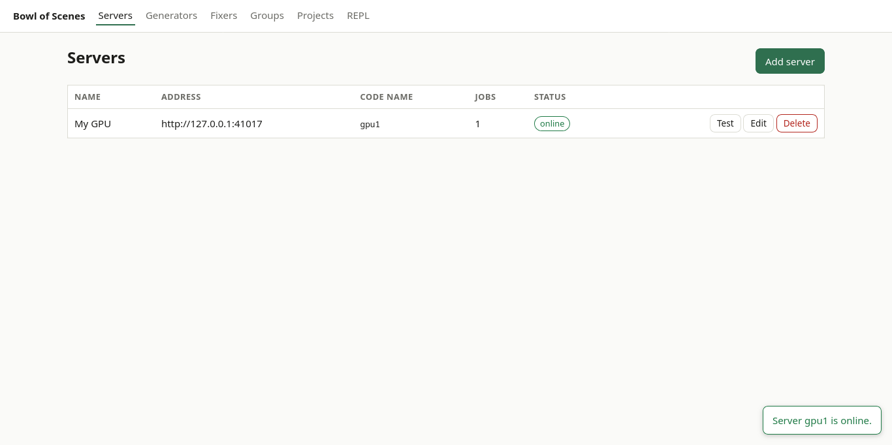
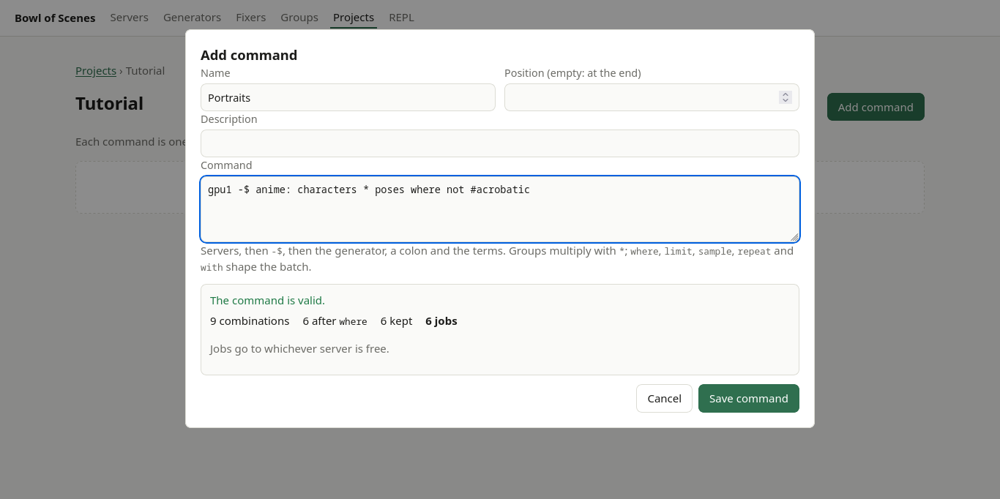
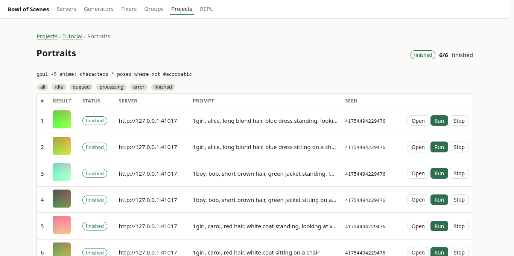

# Tutorial: your first batch

In this tutorial you start the program, tell it about your ComfyUI, teach it a few characters and poses, and make a batch of pictures with one line. You do it twice: **in the web page** first, then **from a terminal** with `bosctl`. Allow half an hour; most of it is waiting for pictures.

**You need:** the program built (see the [README](../README.md#install-and-run)), and a ComfyUI that you can reach, with the checkpoint `waiIllustriousSDXL_v160.safetensors` installed. (If you have another checkpoint, open `examples/workflows/creators/illustrious_xl.json` in a text editor and change the name in the node `Load Checkpoint`; or use your own workflow, see [generators](guide/catalogue.md#generators).) Every address below assumes ComfyUI is at `http://127.0.0.1:8188`; use yours if it is elsewhere.

## 0. Start the program

```sh
cp config.example.json config.json
./bin/bos -config config.json
```

Leave it running. Open <http://127.0.0.1:8080>. You should see the home page with a short checklist and zeros everywhere.

## Part 1: in the web page

### 1. Add your ComfyUI server

*Servers → Add server*. Fill in:

- **Name:** `My GPU`
- **Address:** `http://127.0.0.1:8188`
- **Code name:** `gpu1` (this is what you will type in commands)
- **Jobs at once:** `1`

Press *Save*. The table shows the server with a green **online** badge within a second. If it says **offline**, press *Test*: the message tells you why (usually a wrong address, or ComfyUI started without `--listen` when it is on another machine).



### 2. Add a generator

*Generators → Add generator*. Fill in **Name** `Anime` and **Code name** `anime`. Open `examples/workflows/creators/illustrious_xl.json` and either paste its content into the workflow box or choose it with *…or load it from a file*. The dialog analyses the workflow by itself and says *Found: image output at “Save Image”*, and fills **Positive prompt node** with `Positive` and **Negative prompt node** with `Negative`: the nodes whose titles start with those words. (A generator needs a positive prompt node; with another workflow, type the title of its node there.) Press *Save*.

### 3. Add a fixer

*Fixers → Add fixer*. **Name** `Upscale`, **Code name** `upscale`, load `examples/workflows/fixers/simple_upscale.json`; the dialog analyses it by itself and fills **Image-input node** with `Load Image` and **Image-output node** with `Save Image` (when the workflow has only one candidate for each; otherwise choose from the list). Save.

### 4. Add groups of items

*Groups → Add group*: **Name** `Characters`, **Code name** `characters`, tick nothing else. Save. Click the group's name to open its items and press *Add item*:

| Code name | Name | Positive prompt |
|---|---|---|
| `alice` | Alice | `1girl, alice, long blond hair, blue dress` |
| `bob` | Bob | `1boy, bob, short brown hair, green jacket` |
| `carol` | Carol | `1girl, carol, red hair, white coat` |

Do the same for a group `poses` (**Name** `Poses`) with the items `standing` (`standing, looking at viewer`), `jumping` (`jumping, mid-air`, **Tags:** `acrobatic`) and `sitting` (`sitting on a chair`).

The *tags* of an item let a command pick items by label: `jumping` is tagged `acrobatic`.

### 5. Make a project and preview a command

*Projects → Add project*, name it `Tutorial`, then press *Commands* on its row and *Add command*. In the **Command** box type:

```
gpu1 -$ anime: characters * poses where not #acrobatic
```

As you type, short lists of names that fit appear under the box (try `gpu1 -$ an` and press `Tab`); take them with `Tab` or a click. The panel below answers: *The command is valid*, **9** combinations, **6** after `where` (the three characters times the two poses that are not acrobatic), **6 jobs**. Try breaking it: change `poses` to `pose`. The mistake is underlined in your text and *Save command* is disabled. Put it back.



Give it the name `Portraits` and press *Save command*. The command appears in the list as **idle, 0/6**.

### 6. Run it

Press *Run*. The status becomes **queued**, then **processing**. Click the command's name to open its **jobs**: a table with one row per job. Rows change on their own as jobs start and finish, small pictures appear, and messages come up in the corner (*3 jobs finished*). When all six are done the command is **finished, 6/6**.



Click *Open* on a job to see its prompts and seed. Change a word in the positive prompt and press *Save prompts*: the job starts over (its picture is deleted and it is idle). Press *Run* on that row to make it again.

Back in the command list, press **Download**: you get a ZIP with the six pictures and `summary.json`.

### 7. Add a fixer to the batch and use the REPL

Add a second command, `gpu1 -$ anime: characters(alice) * poses > upscale`, named `Upscaled`. Each job now has two steps: it is generated, then sent through `upscale`, and the picture is replaced by the larger one. Run it and watch a job go *processing → queued → processing → finished*.

For a quick one-off picture without a project, open **REPL**: choose the server and generator, type `a red fox` as the positive prompt, and press *Run*. The picture appears in the result box when it is done.

## Part 2: the same from a terminal

`bosctl` does everything the web page does. Open a second terminal in the folder of the program, with `bin/` in your path (or write `./bin/bosctl`). It looks for the server at `http://127.0.0.1:8080`; set `BOS_SERVER` if yours is elsewhere. Start from a **fresh** database if you did Part 1 (delete the `data` folder while the program is stopped), because the numbers below are the ones a fresh start gives.

Every block below that is marked `bosctl` is **run by the project's tests** against a stand-in ComfyUI, so what you read here works. A comment `# exit 1` marks a command that is expected to fail.

### Set up the catalogue

```bosctl
bosctl server create --name "My GPU" --host http://127.0.0.1:8188 --code-name gpu1
bosctl generator create --name Anime --code-name anime --workflow @examples/workflows/creators/illustrious_xl.json --positive-title Positive --negative-title Negative
bosctl fixer create --name Upscale --code-name upscale --workflow @examples/workflows/fixers/simple_upscale.json --load-title "Load Image" --save-title "Save Image"
bosctl server list
```

The `@` in `--workflow @file` means “read the file”. Each command prints what it made; `server list` shows the table. `--json` on any command prints the raw answer for scripts.

### Groups and items

```bosctl
bosctl group create --name Characters --code-name characters
bosctl item create 1 --code-name alice --name Alice --positive-prompt "1girl, alice, long blond hair, blue dress"
bosctl item create 1 --code-name bob --name Bob --positive-prompt "1boy, bob, short brown hair, green jacket"
bosctl item create 1 --code-name carol --name Carol --positive-prompt "1girl, carol, red hair, white coat"
bosctl group create --name Poses --code-name poses
bosctl item create 2 --code-name standing --name Standing --positive-prompt "standing, looking at viewer"
bosctl item create 2 --code-name jumping --name Jumping --positive-prompt "jumping, mid-air" --tags acrobatic
bosctl item create 2 --code-name sitting --name Sitting --positive-prompt "sitting on a chair"
bosctl item list 2
```

A group can also be made from a text file with one item per line: `bosctl group import-text --name Places --code-name places --text @places.txt`.

### A project and its first command

```bosctl
bosctl project create --name Tutorial
bosctl command preview 'gpu1 -$ anime: characters * poses where not #acrobatic'
bosctl command preview 'gpu1 -$ anime: characters * pose'
bosctl command add 1 'gpu1 -$ anime: characters * pose' --name Broken   # exit 1
bosctl command add 1 'gpu1 -$ anime: characters * poses where not #acrobatic' --name Portraits
bosctl command list 1
bosctl job list 1 --page-size 3
```

The first preview says **6 jobs**. The second is not valid, and `preview` says where; trying to *add* it fails with exit code 1 and the same list of problems. Note the single quotes: they keep the shell from touching `$`, `*` and `>`.

### Run and watch

```bosctl
bosctl command run 1 --wait --timeout 5m
bosctl events
bosctl job show 1
bosctl command download 1 --output tutorial-results.zip
```

`--wait` prints every change of the job counts (`queued: 6 queued of 6 jobs`, then `processing: …`, then `finished: 6 finished of 6 jobs`) and ends when the command is done; the exit code tells whether it succeeded. Use `bosctl events --follow` in another terminal to watch the events as they happen.

### Fixers, templates and the REPL

```bosctl
bosctl command add 1 'gpu1 -$ anime: characters(alice) * poses > upscale' --name Upscaled
bosctl command run 2 --wait --timeout 5m
bosctl repl run --on gpu1 --generator anime --positive "a red fox" --items 'characters(alice)'
bosctl repl last
```

### Tags

```bosctl
bosctl tag list --scope item
bosctl tag rename --scope item --from acrobatic --to action
bosctl command show 1
```

The rename tells you which commands mention the old tag; `Portraits` does (`where not #acrobatic`), so it will not validate again until you edit it to say `#action`:

```bosctl
bosctl command edit 1 --code 'gpu1 -$ anime: characters * poses where not #action'
bosctl command recreate 1
```

### Clean up

```bosctl
bosctl command delete 2
bosctl command delete 1
bosctl project delete 1
```

## Where to go next

- The [command language](guide/commands.md): ranges, patterns, merges, templates, regions, `sample`, `repeat`, spreading across servers.
- Add a second server and write `gpu1, gpu2 -$ …` to split the work.
- [Import LoRAs from Civitai](guide/civitai.md).
- Something went wrong? [Troubleshooting](troubleshooting.md) lists every error by its name.
